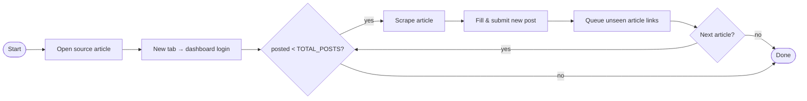

<div align="center">

# 🧰 Tools

**A personal monorepo of small, independent automation tools.**

One folder per tool. Its own code, dependencies and runtime. No shared baggage.


[Tools](#-tools) · [Structure](#-structure) · [Quick start](#-quick-start) · [Add a tool](#-adding-a-new-tool)

</div>

---

## ✨ Why this layout

| | |
|---|---|
| 📦 **One folder = one tool** | Everything a tool needs lives under `apps/<tool>/`. |
| 🔌 **Fully independent** | Each tool has its own dependencies, config and runtime. |
| 🐍 + 🟨 **Polyglot** | Python tools are managed by a **uv** workspace; JavaScript tools by **npm** workspaces. |
| 🪶 **No shared layer by default** | Add a `packages/` folder only when you actually need shared code. |

---

## 🛠 Tools

### 🕷️ `scrap-erki`: content scraper and auto-poster

> `apps/scrap-erki/` · Python · Selenium

Reads articles from **earki.co** and publishes them to a dashboard, one after another, in a single Chrome window.

**What it does**

- 🗂️ **Two tabs**: the source site in one, the dashboard in the other.
- 🔐 **Logs in** to the dashboard automatically.
- 📰 **Scrapes** each article's title, author, image, body, description and source URL.
- 📝 **Fills the post form**, picks a random category and adds 2 to 4 random tags.
- 🔁 **Crawls on its own**: queues unseen article links from each page and never visits the same one twice.
- 🛡️ **Recovers from failures**:
  - Inputs are pasted with JS (React-safe) and typed by hand if the paste doesn't stick.
  - Layered fallback selectors for the image, source-URL field and submit button.
  - A failed article is skipped instead of crashing the run.

**How it works**



**Configuration** (constants at the top of [`scrapper.py`](apps/scrap-erki/scrapper.py))

| Setting | Default | Purpose |
|---|---|---|
| `START_URL` | an earki.co article | Where scraping begins |
| `LOGIN_URL` / `NEW_POST_URL` | dashboard URLs | Where posts are published |
| `TOTAL_POSTS` | `50` | How many posts to publish before stopping |
| `MIN_WAIT` / `MAX_WAIT` | `0.4` / `0.8` s | Random delay before click actions |
| `TAG_POOL` | `news`, `story`, … | Tags picked at random for each post |
| `SRC_*` | CSS selectors | Source-site element selectors |

---

## 🗂 Structure

```text
tools/
├── apps/                      # every tool lives here
│   └── scrap-erki/            # 🕷️ Selenium scraper → dashboard poster
│       ├── pyproject.toml
│       └── scrapper.py
├── package.json               # npm workspaces  → apps/*
├── pyproject.toml             # uv workspace    → apps/*, packages/*
└── README.md
```

---

## 🚀 Quick start

### Prerequisites

- **Python 3.11+** and [**uv**](https://docs.astral.sh/uv/) (or plain `pip`)
- **Google Chrome**. Selenium 4.6+ downloads the matching driver for you.
- **Node.js** (only for JavaScript tools)

### Run `scrap-erki`

```bash
cd apps/scrap-erki

# with uv
uv sync
uv run scrapper.py

# or with pip
python3 -m venv .venv && source .venv/bin/activate
pip install selenium
python3 scrapper.py
```

A Chrome window opens and the tool starts posting. When it's done, press **Enter** in the terminal to close the browser.

### Run JavaScript tools (from the repo root)

```bash
npm install
npm run dev     # runs `dev` in every workspace that defines it
npm run build   # likewise: build / test / lint
```

---

## ➕ Adding a new tool

<details>
<summary><b>🐍 Python tool</b></summary>

```bash
mkdir -p apps/my-tool && cd apps/my-tool
uv init --package     # creates pyproject.toml
uv add <deps>
```

The root `pyproject.toml` already includes `apps/*` in the uv workspace, so nothing else needs to change.

</details>

<details>
<summary><b>🟨 JavaScript tool</b></summary>

```bash
mkdir -p apps/my-app && cd apps/my-app
npm init -y
```

Add `dev` / `build` / `test` / `lint` scripts to its `package.json` and the root `npm run …` commands pick them up automatically.

</details>

### House rules

1. **One folder = one tool.** Keep everything inside `apps/<tool>/`.
2. **Own your dependencies.** No reaching into another app's code.
3. **Shared code is opt-in.** Create `packages/<name>/` only when two or more tools really need it.

---

<div align="center">

Built with ☕ by [**SadikHasanRafi**](https://github.com/SadikHasanRafi)

</div>
